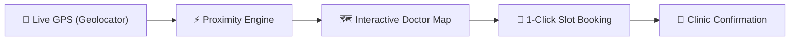
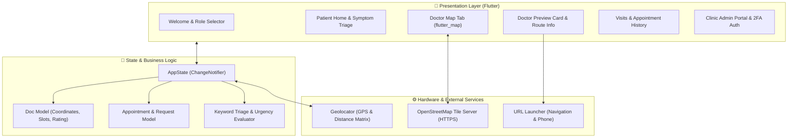
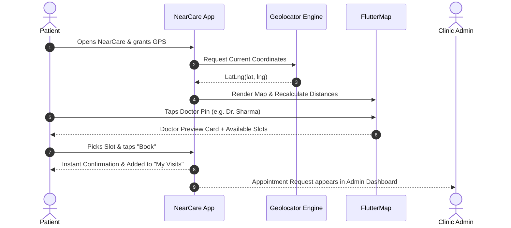

# 🏥 NearCare — Smart Proximity Healthcare & Patient Management

<p align="center">
  
</p>

<p align="center">
  <strong>Find trusted doctors nearby. Navigate with live GPS. Book in under a minute.</strong>
</p>

<p align="center">
  
  
  
  
  
  
</p>

---

## 📑 Table of Contents

- [🌟 Overview](#-overview)
- [✨ Key Features](#-key-features)
- [🏗️ System Architecture](#️-system-architecture)
- [🔄 How It Works](#-how-it-works)
  - [1. Live GPS & Proximity Engine](#1-live-gps--proximity-engine)
  - [2. Interactive OpenStreetMap Engine](#2-interactive-openstreetmap-engine)
  - [3. Specialty & Triage Recommendation](#3-specialty--triage-recommendation)
  - [4. Appointment Lifecycle](#4-appointment-lifecycle)
  - [5. Clinic Admin & Security Portal](#5-clinic-admin--security-portal)
- [📱 Screen-by-Screen Walkthrough](#-screen-by-screen-walkthrough)
- [🚀 Quick Start & Installation](#-quick-start--installation)
- [📁 Project Structure](#-project-structure)
- [🛡️ Permissions & Privacy](#️-permissions--privacy)
- [🤝 Contributing & License](#-contributing--license)

---

## 🌟 Overview

**NearCare** is a modern cross-platform Flutter application built to bridge the gap between patients needing timely healthcare and verified local healthcare clinics and doctors. 

By combining **device GPS positioning (`geolocator`)**, **interactive OpenStreetMap rendering (`flutter_map`)**, and **intelligent specialty triage**, NearCare allows users to locate nearby specialists, inspect real-time distances, review clinic profiles, view available time slots, and schedule visits immediately with zero friction.



---

## ✨ Key Features

| Feature | Description | Status |
|---|---|---|
| **🗺️ Live Map Experience** | Full-screen pan/zoom map powered by OpenStreetMap tiles via `flutter_map` without proprietary API key dependencies. | ✅ Active |
| **📍 High-Accuracy GPS** | Auto-detects real-time device location using `geolocator`, calculates distance matrix in km, and dynamically re-ranks doctors. | ✅ Active |
| **🧭 Route Guidance** | Visual dashed polyline connecting user to doctor; one-tap turn-by-turn navigation in external map apps via `url_launcher`. | ✅ Active |
| **🏷️ Interactive Category Filtering** | Real-time filtering chips by medical specialty (*Cardiology, General Physician, Dermatology, Pediatrics, Neurology*) with live provider counts. | ✅ Active |
| **🩺 Symptom Triage Matcher** | Keyword-based matching engine that maps symptoms to relevant medical specialties and triggers emergency advisories. | ✅ Active |
| **📅 Appointment Booking** | Real-time slot reservation, instant confirmation, visit history tracking, and cancellation/reschedule capabilities. | ✅ Active |
| **🛡️ Clinic Admin Portal** | Facility management portal protected by 2FA OTP verification, doctor roster verification, slot publishing, and review moderation. | ✅ Active |

---

## 🏗️ System Architecture



---

## 🔄 How It Works

<details open>
<summary><strong>1. Live GPS & Proximity Engine (Click to collapse/expand)</strong></summary>

NearCare uses `geolocator` to query device location hardware:
1. **Permission Check**: Verifies `isLocationServiceEnabled()` and checks permissions (`checkPermission()` / `requestPermission()`).
2. **Coordinate Acquisition**: Obtains high-accuracy device coordinates (`LocationAccuracy.high`).
3. **Proximity Calculation**: Calculates exact distances to each doctor's clinic coordinates using the Haversine formula via `Geolocator.distanceBetween(lat1, lng1, lat2, lng2) / 1000.0`.
4. **Dynamic Sorting**: Automatically updates the sorting order so the closest available doctors appear first.

```dart
// Location & Distance Calculation in AppState
final pos = await Geolocator.getCurrentPosition(
  locationSettings: const LocationSettings(accuracy: LocationAccuracy.high),
);
userLocation = LatLng(pos.latitude, pos.longitude);

for (final d in docs) {
  final meters = Geolocator.distanceBetween(pos.latitude, pos.longitude, d.lat, d.lng);
  d.dist = double.parse((meters / 1000.0).toStringAsFixed(1));
}
notifyListeners();
```
</details>

<details>
<summary><strong>2. Interactive OpenStreetMap Engine (Click to collapse/expand)</strong></summary>

Unlike proprietary mapping engines that require paid API keys and credit cards, NearCare uses **OpenStreetMap** with `flutter_map`:
- **Tile Streaming**: Streams OpenStreetMap tiles dynamically (`https://tile.openstreetmap.org/{z}/{x}/{y}.png`).
- **Pulsing User Beacon**: Displays a multi-layer glowing navigation beacon at the user's GPS position.
- **Doctor Specialty Pins**: Custom colored pins displaying icons, doctor specialty tags, and active selection state without overflow clipping.
- **Route Polyline**: When a doctor pin is tapped, a dashed line connects the patient to the doctor on the map, illustrating straight-line distance and orientation.
- **External Directions**: Tapping "Directions" launches native Google Maps or Apple Maps with the doctor's exact latitude, longitude, and facility name.
</details>

<details>
<summary><strong>3. Specialty & Triage Recommendation (Click to collapse/expand)</strong></summary>

Patients can enter symptoms into the triage bar (e.g., *"severe chest pain"* or *"skin rash"*):
- Matches keywords to specialties (*Cardiology, Dermatology, Neurology, Pediatrics, General Physician*).
- Evaluates urgency markers: if acute terms (*chest*, *breath*, *faint*) are detected, displays a high-priority warning advising the user to contact emergency services (112) immediately.
</details>

<details>
<summary><strong>4. Appointment Lifecycle (Click to collapse/expand)</strong></summary>


</details>

<details>
<summary><strong>5. Clinic Admin & Security Portal (Click to collapse/expand)</strong></summary>

For clinic staff and hospital receptionists:
- **Two-Factor Authentication**: Enforces clinic ID (`CC-XXXX`), corporate email, password, and 6-digit authenticator code (TOTP).
- **Roster & Doctor Management**: Toggle doctors as active/hidden and set verification status.
- **Booking Requests**: Review incoming patient requests; confirm or reject slots.
- **Review Moderation**: Approve or flag patient reviews.
</details>

---

## 📱 Screen-by-Screen Walkthrough

<details open>
<summary><strong>Interactive Feature Tour</strong></summary>

### 🏠 1. Home Screen
- **Location Bar**: Shows current searching locality (e.g. `📍 Indirapuram, Ghaziabad`). Tapping it immediately triggers live GPS re-acquisition.
- **Symptom Box**: Hero input field for natural language symptom entry.
- **Specialty Filter Bar**: Quick carousel of medical specialties.
- **Provider List**: Cards displaying doctor avatar, name, facility, rating, fee (₹), distance (km), and matching explanation.

### 🗺️ 2. Map Screen (`MapTab`)
- **OpenStreetMap Canvas**: Smooth pan, pinch-zoom, and map rotation.
- **Floating Controls**:
  - `My GPS` button: Refreshes GPS position and centers camera on user.
  - `Fit All`: Re-centers camera bounds to show all doctors and user simultaneously.
  - `+` / `-`: Quick zoom buttons.
- **Category Chips**: Filter pins on the map in real time with counts (e.g., `Cardiology (1)`).
- **Interactive Doctor Bottom Sheet**: Shows doctor info, rating, live distance, "Directions" button, "Call" button, and direct "Book" button.

### 📅 3. Visits Screen
- History of confirmed, pending, and past appointments.
- Status badges: `confirmed`, `requested`, `cancelled`.
- Actions to reschedule or cancel bookings.

### 📁 4. Records Screen
- Personal health record summaries (blood tests, prescriptions, ECG reports).
- Privacy tags ensuring records remain confidential.

### 🛡️ 5. Clinic Admin Portal
- Dashboard metrics: Awaiting confirmation, Weekly bookings, Active staff, Pending reviews.
- Quick action shortcuts: Add doctor, Publish slots, Audit logs.
</details>

---

## 🚀 Quick Start & Installation

### Prerequisites
- **Flutter SDK** (v3.12 or higher)
- **Dart SDK** (v3.0 or higher)
- **Android Studio** / **VS Code** with Flutter & Dart extensions
- Connected Android/iOS device or emulator / Chrome browser

### 1. Clone the Repository
```bash
git clone https://github.com/your-username/Patient-Management.git
cd "Patient Management"
```

### 2. Install Dependencies
```bash
flutter pub get
```

### 3. Run the App
```bash
# Run on connected phone or emulator
flutter run

# Run on Chrome
flutter run -d chrome

# Run on Windows desktop
flutter run -d windows
```

### 4. Run Unit Tests & Analyzer
```bash
# Run static code analysis
flutter analyze

# Run unit tests
flutter test
```

---

## 📁 Project Structure

```text
Patient Management/
├── android/                  # Android native project & manifest
│   └── app/src/main/
│       └── AndroidManifest.xml # Location & Internet permissions
├── ios/                      # iOS native project & Info.plist
│   └── Runner/
│       └── Info.plist        # NSLocation usage descriptions
├── web/                      # Flutter Web shell
│   ├── index.html            # Web app title & icons
│   └── manifest.json         # Web PWA manifest
├── lib/
│   └── main.dart             # Main application entry, models, state & UI
├── test/
│   └── app_test.dart         # Unit tests (models, state, coordinates)
├── pubspec.yaml              # Dependencies (flutter_map, geolocator, etc.)
└── README.md                 # Project documentation & guide
```

---

## 🛡️ Permissions & Privacy

### Android ([AndroidManifest.xml](android/app/src/main/AndroidManifest.xml))
```xml
<uses-permission android:name="android.permission.INTERNET"/>
<uses-permission android:name="android.permission.ACCESS_FINE_LOCATION"/>
<uses-permission android:name="android.permission.ACCESS_COARSE_LOCATION"/>
```

### iOS ([Info.plist](ios/Runner/Info.plist))
```xml
<key>NSLocationWhenInUseUsageDescription</key>
<string>NearCare needs your location to show nearby doctors and calculate travel distance.</string>
<key>NSLocationAlwaysAndWhenInUseUsageDescription</key>
<string>NearCare needs your location to show nearby doctors and calculate travel distance.</string>
```

> **Privacy Note**: NearCare only requests location data to calculate proximity to nearby medical providers. Coordinates are processed locally on the client and are never sold or shared with third parties.

---

## 🤝 Contributing & License

Contributions, bug reports, and feature requests are welcome!

1. Fork the Project
2. Create your Feature Branch (`git checkout -b feature/AmazingFeature`)
3. Commit your Changes (`git commit -m 'Add some AmazingFeature'`)
4. Push to the Branch (`git push origin feature/AmazingFeature`)
5. Open a Pull Request

Distributed under the **MIT License**. See `LICENSE` for more information.

---

<p align="center">
  Built with ❤️ using <strong>Flutter</strong> & <strong>OpenStreetMap</strong>
</p>
